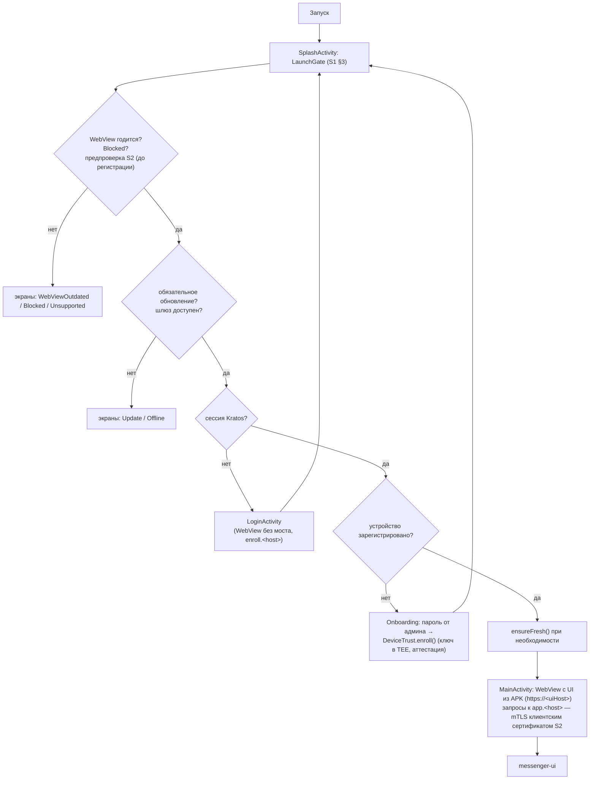
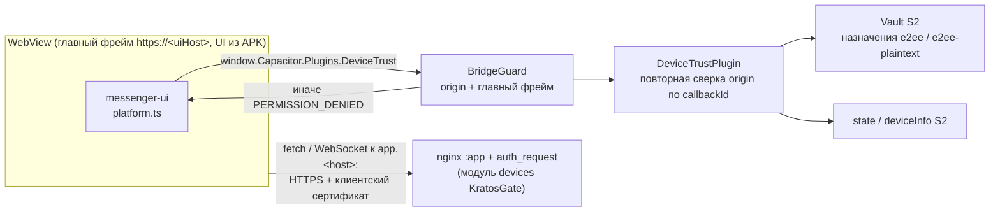

# wolp-android

Android-приложение **Wolp Messenger** (`org.wolpmessenger`): оболочка **Capacitor 8.6** над веб-клиентом [`messenger-ui`](https://github.com/android-messenger/messenger-ui), доступ к серверу — только с зарегистрированного устройства по **mTLS**. Выбор оболочки — [ADR-0001](docs/adr/0001-shell-capacitor.md) (вариант A, Capacitor). Распространяется **файлом APK**, без Google Play и Play Integrity.

Проверка устройства, сертификаты, RASP и Vault — библиотека [`wolp-device-trust`](https://github.com/android-messenger/wolp-device-trust) (S2), подключена подмодулем.

| Документ (`android-messenger/docs`) | О чём |
|---|---|
| `ARCHITECTURE.md` | решения D1–D19, модель угроз, совместимость C1–C9 |
| `specs/S1-android-app.md` | спецификация приложения |
| `specs/S1-plan.md` | план S1-1…S1-9 и ход работ |
| `security/` | концепция безопасности по слоям (не дублируется здесь); оболочка — `07-app-shell.md`, push и звонки — `11-push-calls.md` |
| `install/phone.md` | установка на телефон |

> В комментариях кода встречается прежняя нумерация раздела: `security/09` (UI в APK) — теперь `security/07-app-shell.md`.

## Структура

```
app/                    приложение (S1) — описание и сборка: app/README.md
  android/              Gradle-проект: :app, :capacitor-android (из node_modules), includeBuild S2
    third_party/wolp-device-trust   подмодуль S2 (закреплённый коммит)
  tools/stand-config.sh android/stand.properties для стенда
p1/                     прототип P1 (проверки P1-a…P1-i, протокол — p1/README.md)
  stand/                стенд P1 (nginx mTLS + probe)
  stand/devices/        стенд регистрации и хоста app: KratosGate, Kratos, Oathkeeper, живой мессенджер
docs/adr/               архитектурные решения (ADR-0001 — оболочка Capacitor)
.github/workflows/app.yml   CI приложения
```

Основные классы `app/android/app/src/main/java/org/wolpmessenger/`:

| Где | Что |
|---|---|
| `WolpApp` | `DeviceTrust.init`, единственный подписчик `events` |
| `SplashActivity`, `launch/LaunchGate` | порядок проверок при запуске (S1 §3), экраны Compose (`ui/Screens`). Единственный экспортируемый компонент: содержимому своего Intent не доверяет |
| `launch/LaunchHandoff`, `push/TapActivity` | передача между своими компонентами в памяти процесса: нажатие на уведомление (через неэкспортируемую `TapActivity`), причина возврата из `MainActivity`, допуск `MainActivity` после порядка §3 |
| `LoginActivity` | вход в Kratos в обычной WebView **без** моста |
| `MainActivity`, `WolpWebViewClient`, `WolpWebChromeClient` | Capacitor `Bridge` (создаётся только с допуском от `SplashActivity`), клиентский сертификат, `X-Device-Deny`, разрешения, «Назад», VaultReset |
| `web/BridgeGuard`, `web/BridgePolicy` | защита моста: только главный фрейм упакованного UI (`https://<uiHost>`) |
| `plugins/DeviceTrustPlugin` | `getState`, `getDeviceInfo`, `vaultWrap`/`vaultUnwrap` |
| `plugins/FilesPlugin` | сохранение вложения через системный диалог, загрузка закреплённым клиентом S2 |
| `plugins/PushPlugin`, `push/` | FCM: регистрация токена и ключа нагрузки, расшифровка push, уведомления без текста сообщений, закрытие WebSocket веб-клиента в фоне |
| `plugins/CallPlugin`, `call/` | звонки: foreground-сервисы звонка и вызова, экран входящего поверх блокировки, маршрут звука, нативный отказ |
| `plugins/AppSettingsPlugin`, `AppLocale` | язык нативных экранов и уведомлений (английский, испанский) по языку веб-клиента |

## Как работает приложение

Интерфейс `messenger-ui` **упакован в APK** (app-сборка `messenger-ui`, `security/07-app-shell.md`): Capacitor отдаёт `assets/public` как `https://<uiHost>/` без сети; API, WebSocket и Kratos — на `https://app.<host>` (mTLS, cookie Kratos, CORS для origin UI). `server.url` не используется.





- Отказ шлюза (`X-Device-Deny`) с `app.<host>` → `web/DenyPolicy`: проверка по закреплённому каналу S2, при подтверждении — блокировка и очистка.
- 401 без заголовка на документе → сессию спрашивают у Kratos напрямую; нет — вход.
- Выход в веб-клиенте (маршрут `login`/`register`) → нативный `LoginActivity`; если сессии Kratos уже нет, заодно удаляются токен FCM, ключ push и кэш имён.
- Пользователь сертификата ≠ пользователь сессии → выход из Kratos и экран «Другой пользователь».
- Нажатие на уведомление и «Принять» на экране звонка идут через неэкспортируемую `TapActivity`; `SplashActivity` экспортирована и из своего Intent ничего не берёт — чужое приложение не может подсунуть ссылку на звонок.
- `MainActivity`, которую система восстановила после гибели процесса, UI не загружает и возвращается к порядку проверок.

Подробно о мерах защиты — `android-messenger/docs` → `security/` (`07-app-shell.md`, `06-keystore-vault.md`, `08-rasp.md`, `10-gateway.md`, `11-push-calls.md`).

### Почему UI упакован в APK (решение владельца 2026-11-09, реализовано)

Интерфейс **упакован в APK**. Причина: код, загруженный с сервера, может вызывать Vault через мост — взлом сервера дал бы чтение E2EE; код внутри APK подписан. Единая кодовая база `messenger-ui`: web-сборка → сервер для браузера, app-сборка → внутрь APK при сборке (`wolp.uiDist`, см. `app/README.md`). Подробности — `security/07-app-shell.md`. ADR-0001 описывает прежнюю конфигурацию (`server.url = https://app.<host>`), которая больше не используется.

## Состояние (план S1)

| Задача | Что | Состояние |
|---|---|---|
| S1-1 | каркас `app/`, подмодуль S2, flavors, CI | слит (#4) |
| S1-2 | порядок запуска, нативные экраны, вход Kratos, онбординг, очистка при блокировке | слит (#5) |
| S1-3 | WebView и mTLS | слит (#6) |
| S1-4 | плагин `DeviceTrust`, защита моста | слит (#7) |
| — | стенд с живым мессенджером | слит (#8) |
| S1-5 | правки `messenger-ui` + нативный вход по маршруту веб-клиента | слит (#9, `messenger-ui` #1) |
| — | перенос UI в APK | слит (#11) |
| — | плагин `Files`: сохранение вложений | слит (#12) |
| S1-7 | push (FCM) | слит (#13, #14, #24) |
| S1-6 | звонки | слит (#15, #23) |
| — | обязательное обновление по минимальной версии шлюза (`X-Device-Min-App-Version`) | слит (#16) |
| — | язык нативных текстов: английский и испанский | слит (#19, #20) |
| — | исправления по аудиту 2026-11-12: нажатия только от своих компонентов, допуск `MainActivity` | слит |
| S1-8 | обновления (манифест Ed25519, `PackageInstaller`) и упрочнение | не начато; экран Update только сообщает о необходимости обновления, установить его из приложения нельзя |
| S1-9 | регрессия и пилот | не начато |

Проверено на **Galaxy A37** (SM-A376B, Android 16, TEE, без StrongBox) через стенд.

## Сборка

Нужны **JDK 21** (Gradle 8.14 не работает на JDK 25), Android SDK (`ANDROID_HOME`), NDK для урезания `libwolpdt.so`, Node.js для `npm ci`.

```bash
git submodule update --init
cd app && npm ci && cd android
export JAVA_HOME=<JDK 21> ANDROID_HOME=<Android SDK>
../tools/stand-config.sh          # стенд: пишет android/stand.properties (хосты, пины, корень стенда, uiHost)
(cd ../../../messenger-ui/front && VITE_API_ORIGIN=https://localhost:9444 VITE_TURN_HOST=localhost npm run build:app)
./gradlew :app:assembleProductDebug -Pwolp.uiDist=../../../messenger-ui/front/dist-app
```

Без свойств `wolp.*` и без app-сборки `messenger-ui` сборка останавливается на `validateWolpConfig`. Хосты, пины сервера, каталог UI, подпись и версии — таблица в [`app/README.md`](app/README.md#конфигурация-gradle-свойства-wolp). `wolp.uiDist` по умолчанию — `../../../messenger/front/dist-app`, то есть клон `messenger-ui` в соседнем каталоге `messenger`; при другом имени каталога путь задаётся явно, как выше.

| Вариант | Назначение |
|---|---|
| `productDebug`, `pilotDebug` | разработка; RASP понижает `APP_DEBUGGABLE`/`DEBUGGER` до REPORT; доверяет корню стенда |
| `productRelease` | боевая сборка, R8 |
| `pilotRelease` | пилот: RASP в режиме dry run, `versionCode` 90–99 в младших разрядах |

Перед каждой release-сборкой `verify<Variant>BuildKind` отказывает при неверном типе сборки, `versionCode` вне диапазона, отсутствии или чужой подписи, хосте стенда. Подробно — `app/README.md`.

**CI** (`.github/workflows/app.yml`): debug-сборка, JVM-тесты и Android lint, обе release-сборки одноразовым ключом, отрицательные проверки `verify*` и упаковки UI, урезанная `libwolpdt.so`, отсутствие корня стенда в release. UI в CI — заглушка, настоящий `messenger-ui` там не собирается. Actions закреплены по SHA коммита. Приватный подмодуль `wolp-device-trust` забирается deploy-ключом (секрет `DEVICE_TRUST_DEPLOY_KEY`) или fine-grained токеном (`DEVICE_TRUST_TOKEN`).

## Стенд

`p1/stand/devices` — локальный стенд для телефона по USB (`adb reverse`): KratosGate с модулем `devices`, Kratos, Oathkeeper, хост `app` с mTLS; по `messenger-up.sh` — бэкенд Hormigas как есть и сборка `messenger-ui`. Запуск и результаты проверок — [`p1/stand/devices/README.md`](p1/stand/devices/README.md):

| Скрипт | Что |
|---|---|
| `up.sh` | PKI стенда, `docker compose`, ожидание готовности |
| `enroll.sh` | пользователь Kratos → вход → пароль онбординга → регистрация на телефоне |
| `app-check.sh` | проверки хоста `app` без телефона (синтетическое устройство) |
| `renew.sh` | короткие сертификаты → регистрация → продление на телефоне |
| `messenger-up.sh` | режим живого мессенджера (`down` — обратно к пробе) |

Стенд не повторяет прод полностью: каталог ключей на нём — исходный Hormigas без правил `KD_SINGLE_DEVICE` / `KD_APP_ONLY_WRITES`, которые в проде включены.

## Установка на телефон

Для пользователей и администраторов — `android-messenger/docs` → `install/phone.md` (требования к телефону, проверка подписи APK, установка из файла, онбординг).

## Лицензия

AGPL-3.0-or-later, см. [LICENSE](LICENSE).
