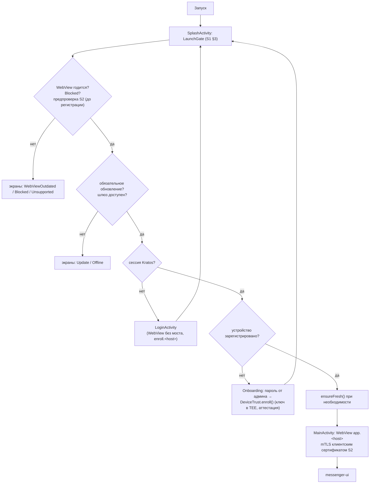
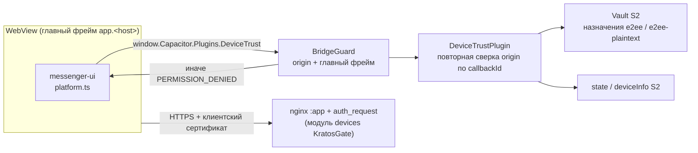

# wolp-android

Android-приложение **Wolp Messenger** (`org.wolpmessenger`): оболочка **Capacitor 8.6** над веб-клиентом [`messenger-ui`](https://github.com/android-messenger/messenger-ui), доступ к серверу — только с зарегистрированного устройства по **mTLS**. Выбор оболочки — [ADR-0001](docs/adr/0001-shell-capacitor.md) (вариант A, Capacitor). Распространяется **файлом APK**, без Google Play и Play Integrity.

Проверка устройства, сертификаты, RASP и Vault — библиотека [`wolp-device-trust`](https://github.com/android-messenger/wolp-device-trust) (S2), подключена подмодулем.

| Документ (`android-messenger/docs`) | О чём |
|---|---|
| `ARCHITECTURE.md` | решения D1–D19, модель угроз, совместимость C1–C9 |
| `specs/S1-android-app.md` | спецификация приложения |
| `specs/S1-plan.md` | план S1-1…S1-9 и ход работ |
| `security/` | концепция безопасности (не дублируется здесь) |
| `install/phone.md` | установка на телефон |

> Раздел `security/` и `install/` — в PR `docs` #1 (на согласовании).

## Структура

```
app/                    приложение (S1) — описание и сборка: app/README.md
  android/              Gradle-проект: :app, :capacitor-android (из node_modules), includeBuild S2
    third_party/wolp-device-trust   подмодуль S2 (закреплённый коммит)
  tools/stand-config.sh android/stand.properties для стенда
p1/                     прототип P1 (проверки P1-a…P1-i, протокол — p1/README.md)
  stand/                стенд P1 (nginx mTLS + probe)
  stand/devices/        стенд регистрации и хоста app: KratosGate, Kratos, Oathkeeper, живой мессенджер
docs/adr/               архитектурные решения (ADR-0001 — оболочка Capacitor)
.github/workflows/app.yml   CI приложения
```

Основные классы `app/android/app/src/main/java/org/wolpmessenger/`:

| Где | Что |
|---|---|
| `WolpApp` | `DeviceTrust.init`, единственный подписчик `events` |
| `SplashActivity`, `launch/LaunchGate` | порядок проверок при запуске (S1 §3), экраны Compose (`ui/Screens`) |
| `LoginActivity` | вход в Kratos в обычной WebView **без** моста |
| `MainActivity`, `WolpWebViewClient`, `WolpWebChromeClient` | Capacitor `Bridge`, клиентский сертификат, `X-Device-Deny`, разрешения, «Назад», VaultReset |
| `web/BridgeGuard`, `web/BridgePolicy` | защита моста: только главный фрейм `app.<host>` |
| `plugins/DeviceTrustPlugin` | `getState`, `getDeviceInfo`, `vaultWrap`/`vaultUnwrap` |

## Как работает приложение

Текущее состояние: интерфейс `messenger-ui` загружается **с сервера** (`server.url` Capacitor = `https://app.<host>`, путь `/messenger-ui/`).





- Отказ шлюза (`X-Device-Deny`) с `app.<host>` → `web/DenyPolicy`: проверка по закреплённому каналу S2, при подтверждении — блокировка и очистка.
- 401 без заголовка на документе → сессию спрашивают у Kratos напрямую; нет — вход.
- Выход в веб-клиенте (маршрут `login`/`register`) → нативный `LoginActivity`.
- Пользователь сертификата ≠ пользователь сессии → выход из Kratos и экран «Другой пользователь».

Подробно о мерах защиты — `docs/security/` (`04-gateway-mtls.md`, `07-rasp.md`, `08-e2ee-vault-bridge.md`).

### Целевое состояние (решение владельца 2026-11-09, ещё не реализовано)

Интерфейс будет **упакован в APK**. Причина: код, загруженный с сервера, может вызывать Vault через мост — взлом сервера дал бы чтение E2EE; код внутри APK подписан. Единая кодовая база `messenger-ui`: web-сборка → сервер для браузера, app-сборка → внутрь APK подмодулем фиксированной версии. Подробности — `docs/security/09-ui-in-apk.md`. Спецификации и ADR-0001 пока описывают текущее состояние.

## Состояние (план S1)

| Задача | Что | Состояние |
|---|---|---|
| S1-1 | каркас `app/`, подмодуль S2, flavors, CI | слит (#4) |
| S1-2 | порядок запуска, нативные экраны, вход Kratos, онбординг, очистка при блокировке | слит (#5) |
| S1-3 | WebView и mTLS | слит (#6) |
| S1-4 | плагин `DeviceTrust`, защита моста | слит (#7) |
| — | стенд с живым мессенджером | слит (#8) |
| S1-5 | правки `messenger-ui` + нативный вход по маршруту веб-клиента | слит (#9, `messenger-ui` #1) |
| — | перенос UI в APK | следующее (решение 2026-11-09) |
| S1-6 | звонки | не начато |
| S1-7 | push (FCM) | не начато |
| S1-8 | обновления (манифест Ed25519, `PackageInstaller`) и упрочнение | не начато; экран Update — заглушка |
| S1-9 | регрессия и пилот | не начато |

Проверено на **Galaxy A37** (SM-A376B, Android 16, TEE, без StrongBox) через стенд.

## Сборка

Нужны **JDK 21** (Gradle 8.14 не работает на JDK 25), Android SDK (`ANDROID_HOME`), NDK для урезания `libwolpdt.so`, Node.js для `npm ci`.

```bash
git submodule update --init
cd app && npm ci && cd android
./gradlew :app:assembleProductDebug
```

Хосты, пины сервера, подпись и версии задаются Gradle-свойствами `wolp.*` — таблица в [`app/README.md`](app/README.md#конфигурация-gradle-свойства-wolp). Для стенда их пишет `app/tools/stand-config.sh`.

| Вариант | Назначение |
|---|---|
| `productDebug`, `pilotDebug` | разработка; RASP понижает `APP_DEBUGGABLE`/`DEBUGGER` до REPORT; доверяет корню стенда |
| `productRelease` | боевая сборка, R8 |
| `pilotRelease` | пилот: RASP в режиме dry run, `versionCode` 90–99 в младших разрядах |

Перед каждой release-сборкой `verify<Variant>BuildKind` отказывает при неверном типе сборки, `versionCode` вне диапазона, отсутствии или чужой подписи, хосте стенда. Подробно — `app/README.md`.

**CI** (`.github/workflows/app.yml`): debug-сборка и JVM-тесты, обе release-сборки одноразовым ключом, отрицательные проверки `verify*`, урезанная `libwolpdt.so`, отсутствие корня стенда в release. Приватный подмодуль `wolp-device-trust` забирается deploy-ключом (секрет `DEVICE_TRUST_DEPLOY_KEY`) или fine-grained токеном (`DEVICE_TRUST_TOKEN`).

## Стенд

`p1/stand/devices` — локальный стенд для телефона по USB (`adb reverse`): KratosGate с модулем `devices`, Kratos, Oathkeeper, хост `app` с mTLS; по `messenger-up.sh` — бэкенд Hormigas как есть и сборка `messenger-ui`. Запуск и результаты проверок — [`p1/stand/devices/README.md`](p1/stand/devices/README.md):

| Скрипт | Что |
|---|---|
| `up.sh` | PKI стенда, `docker compose`, ожидание готовности |
| `enroll.sh` | пользователь Kratos → вход → пароль онбординга → регистрация на телефоне |
| `messenger-up.sh` | режим живого мессенджера (`down` — обратно к пробе) |

## Установка на телефон

Для пользователей и администраторов — `docs/install/phone.md` (требования к телефону, проверка подписи APK, установка из файла, онбординг).
